<div align="center">


# Is the open model<br>on par?

**onpar proves which open-weight model can replace your closed-model API, on your own traffic and hardware, then moves you across with a quality gate and a rollback.**

[](docs/50-roadmap.md)
[](#verification)
[](LICENSE)
[](https://dshakes.github.io/onpar/docs/)

**[Website](https://dshakes.github.io/onpar/) &nbsp;·&nbsp; [Docs](https://dshakes.github.io/onpar/docs/) &nbsp;·&nbsp; [Try it in ten seconds](#try-it-in-ten-seconds)**

</div>

| if you are… | run | you get |
|---|---|---|
| **new to all of this** | `onpar` | a conversation. Say what you are building. It asks one question at a time, only when the answer changes the plan, and ends with a model, a quantisation and the memory it needs. |
| **curious how it works** | `onpar learn basics` | fifteen lessons, basics then intermediate. Every figure is computed by the solver for the machine you are sitting at. |
| **an engineer with traffic** | `onpar doctor` | a check of the gateway, the extension and the engine, then the next command to run. |
| **an agent** | `onpar-mcp` | eleven read-only tools. None of them can move production traffic. |

## Why now

Open-weight models are cheap to run, and the gap to closed models is real but task-dependent. On Terminal-Bench 2.0 the best open model scores 67.9 against GPT-5.5's 82.7, self-reported, as of 31 Oct 2026. That is an average. Your four tasks are not the average.

The plumbing caught up. As of 31 Oct 2026, vLLM 0.32 and llama.cpp 0.8 serve the Anthropic `/v1/messages` endpoint, and OpenAI's hosted Evals shut down on 30 Nov 2026. Two questions still stop every migration: **will it run here**, and **is it good enough for our traffic**. onpar answers both on your machine and prints the arithmetic.

## Prove it

Your captured traffic is the benchmark. The verdict is a receipt, not a dashboard.

- **Agent steps, replayed faithfully.** Each step goes back to the candidate teacher-forced, with the tool schemas and results the incumbent saw. Tool arguments are schema-validated and decision agreement is Cohen's κ ([ADR-0020](docs/adr/0020-agentic-evals-replay-the-step-not-the-prompt.md)).
- **Intervals, never bare scores.** Per-task Wilson intervals. A task is proven only when its whole interval clears the bar, and thin evidence prints `?`.
- **The judge is disclosed and measured.** Position bias, length bias and the human-agreement rate from blind `onpar label` appear in every report. A judge alone never promotes.
- **Money as a range.** The saving carries the same interval as the evidence behind it.

<table>
<tr>
<td width="50%"></td>
<td width="50%"></td>
</tr>
<tr>
<td width="50%"></td>
<td width="50%"></td>
</tr>
</table>

## Run it

The other half: what runs on your hardware, configured the way an expert would.

- **Sizing done right.** MoE on total params, GQA on `kv_heads`, MLA on `kv_lora_rank`. Fit calculators get all three wrong.
- **The engine of seven for your silicon.** There are seven engines with adapters today: vLLM, vLLM-TPU, SGLang, llm-d, llama.cpp, MLX and Ollama. The output is a real `vllm serve` or `InferencePool` that runs with onpar uninstalled.
- **Twelve knobs, each with its why.** Context length, concurrency, chunked prefill, prefix reuse, speculative decoding, memory fraction, tensor parallel, structured output, quantisation (fp16 to q3), KV-cache dtype, LoRA fleet and the tool-calling parser. Projections are a roofline estimate, not measured.
- **One artifact, any machine.** It runs as packed, re-solves with the changes reported, or refuses.

<table>
<tr>
<td width="50%"></td>
<td width="50%"></td>
</tr>
<tr>
<td width="50%"></td>
<td width="50%"></td>
</tr>
</table>

## Try it in ten seconds

```bash
uvx --from onpar onpar fit
```

No install, no config, no account, no telemetry. It reads the machine and tells you what fits:

```

  M4 Max · 16 cores · 128 GB · 546 GB/s
  usable for inference: 96 GB

  FEASIBLE at 32,768 context, concurrency 8

  model                     quant   weights      kv   total    free  ~tok/s  license
  ----------------------------------------------------------------------------------------
  Qwen3 32B                 q4        17.2G   64.0G   84.1G   11.9G      15 slow  Apache-2.0 OK
  Qwen3 30B-A3B (MoE)       q8        28.4G   24.0G   56.2G   39.8G      60  Apache-2.0 OK
  Mistral Small 24B         q8        22.0G   40.0G   65.2G   30.8G      14 slow  Apache-2.0 OK
  Phi-4 14B                 q8        13.7G   50.0G   66.3G   29.7G      18  MIT OK
  Llama 3.1 8B              q8         7.5G   32.0G   41.6G   54.4G      32  Llama 3.1 !

  NOT FEASIBLE

  Gemma 3 27B               weights fit (14 GB) but KV at 32,768 ctx x8 (124 GB) puts it 45 GB over the 96 GB available
  Llama 3.3 70B             weights fit (37 GB) but KV at 32,768 ctx x8 (80 GB) puts it 25 GB over the 96 GB available
  Qwen3 235B-A22B (MoE)     weights alone need 123 GB at q4 — MoE sparsity (22B of 235B active) cuts compute, not memory
  DeepSeek V3 (MoE, MLA)    weights alone need 352 GB at q4 — MoE sparsity (37B of 671B active) cuts compute, not memory
  GLM-5.2                   weights alone need 186 GB at q4 — MoE sparsity (32B of 355B active) cuts compute, not memory
  Kimi K2.7 Code            weights alone need 524 GB at q4 — MoE sparsity (32B of 1000B active) cuts compute, not memory
  Kimi K3 (2.8T MoE)        weights alone need 1,467 GB at q4 — MoE sparsity (50B of 2800B active) cuts compute, not memory
  DeepSeek V4 Pro           weights alone need 838 GB at q4 — MoE sparsity (45B of 1600B active) cuts compute, not memory
  MiniMax M3                weights alone need 239 GB at q4 — MoE sparsity (46B of 456B active) cuts compute, not memory

  runtime -> mlx
             Apple silicon: the CUDA engines cannot run here at all. MLX has the better
             batching story of the two Metal options.

  onpar fit --explain <model-id>   # show the arithmetic
```

`onpar fit --explain <model-id>` prints the derivation for any row. When one looks right, `onpar run qwen3-30b-a3b` serves it.

## Run your own proof

**1. Observe.** Capture starts with an explicit command and stops at Ctrl-C:

```bash
onpar observe --upstream https://api.openai.com/v1

  In your request path from now until Ctrl-C, and not after (ADR-0015).
  capture   ~/.onpar/captures.log (key: ~/.onpar/capture.key)
  upstream  https://api.openai.com/v1
  listening http://127.0.0.1:8787
  point your base_url at http://127.0.0.1:8787/v1 and nothing else changes.
```

The Rust gateway captures OpenAI chat, OpenAI Responses and Anthropic Messages as one record. It adds **+0.07 ms** at p95 against a 15 ms budget, measured. Redaction runs before persistence and fails closed, records are encrypted with XChaCha20-Poly1305, and nothing leaves the machine.

**2. Distill, fit, prove.** `onpar distill` clusters captures into task shapes, `onpar fit` sizes the candidates, and `onpar prove` scores them per task:

```
                    Arithmetic  Ticket classific  Structured extra  One-line summari
llama-3.1-8b      98% [87–100]       90% [77–96]     100% [91–100]      98% [91–100]
gpt-4o-mini               100%              100%              100%              100%
```

Agent traffic is scored step by step, with tool-leak detection and whole-session replay from the recording. A miss stops the session. It never makes a live tool call.

```
AGENTIC — did the candidate make the same moves?
  decision agreement 71% [36–92] ⚠ over 7 tool-context steps · κ=0.53 (moderate), chance-corrected
  1 steps the candidate wrote text where the incumbent called a tool · 1 steps it called a tool where the incumbent answered
  per tool, how often the candidate also called it:
    refund                       67% [21–94] ⚠ of 3 · candidate called it 1× unprompted
    lookup                      100% [21–100] ⚠ of 1
```

Give it what the incumbent costs and it prices the move:

```bash
onpar prove evalset.json --incumbent-cost 2847 --candidate-cost 317 \
    --traffic-window '14 days'

  Saving: $2,506–$2,530/mo (~89%) on traffic proven at or above the 90% bar
    100% [99–100] of traffic moved, measured on 400 captured requests
    over 14 days; Wilson score, 95%
```

**3. Migrate and guard.** `onpar migrate` walks the gate. Nothing moves production traffic except shadow mode. `onpar guard` voids the receipt when the model changes behind its name or traffic drifts into shapes never scored.

## Use it from an agent

One core, four surfaces: CLI, MCP server, Python SDK and workbench. An agent gets the same answer you do.

```jsonc
// onpar-mcp — JSON-RPC over stdio, zero dependencies
onpar_fit       // what runs on this machine, at this context and concurrency
onpar_explain   // the full arithmetic behind one verdict — weights, KV, headroom
onpar_where     // the inverse: which hardware would run this, and at what cost
onpar_catalog   // parameters, MoE split, context, licence
onpar_advise    // what to change unprompted, and where production diverged
onpar_build     // the whole flow, multi-turn: pass state back to continue
onpar_distill   // captured traffic -> an eval set, so there is something to prove against
onpar_prove     // run the eval suite: verdict, traffic split, and a receipt
onpar_receipt   // read a proof: what is proven, what must stay, what is unknown
onpar_guard     // does that proof still hold — and if not, which of three ways
onpar_learn     // inference curriculum grounded in this machine's numbers
```

No tool in that registry can move production traffic, and adding one fails the build.

## Where it sits

Every layer has a good incumbent. The gap is the seam between them. As of 31 Oct 2026:


| | capture | replay | stats verdict | sizing | native config | cutover gate + rollback |
|---|---|---|---|---|---|---|
| Kitaru | SDK or trace import | sessions, tools from the recording | — | — | — | CI regression cohorts, not a cutover |
| Langfuse | SDK traces | experiments on prod traces | — | — | — | CI action, not a cutover |
| Braintrust | hosted traces | trace to experiment | — | — | — | — |
| promptfoo | — | output-level | — | — | — | — |
| LiteLLM | proxy | — | — | — | — | — |
| **onpar** | **redacting proxy** | **teacher-forced steps and sessions** | **Wilson, `?`, signed receipt** | **MoE, GQA, MLA** | **seven engines** | **shadow mode only** |

A dash means the capability was not found in that review. Sources: [10 — Landscape](docs/10-landscape.md).

## What it is not

**Not a load balancer.** Not an inference engine, a chat UI, a RAG framework or hosted inference. The gateway is in your request path only while you are migrating, and not after ([ADR-0015](docs/adr/0015-in-the-path-only-while-migrating.md)). Unredacted prompt text never touches disk. Captured traffic is data, never instructions.

## Install

```bash
uvx --from onpar onpar fit           # no install, no deps
pip install onpar                       # or install it
npx onpar-cli@1.3.4 fit                        # same build, via npm
onpar version                              # what you have, and where it came from
```

**`fit` is one package. The evidence half is three:**

```bash
pip install onpar onpar-gateway onpar-core   # observe, distill, prove
```

`onpar doctor` checks all three in the order the loop needs them, and ends with the one command to run next. The commands above are unpinned and fetch the newest release — currently **1.3.4**. `npx onpar-cli@1.3.4` runs `onpar` 1.3.4 and nothing else. Pin it when you need a build to stay put:

```bash
uvx --from onpar==1.3.4 onpar fit   # exactly this build
```

**Versioning.** `onpar version` reads the installed metadata, not a hand-typed string. Through 0.1.4 receipts were stamped `0.1.0`. Fixed in 0.1.5, so a receipt now names the build that produced it.

## Verification

```bash
cargo test --all                                   # 297 Rust
cargo clippy --all-targets -- -D warnings
uv run --with pytest --with pyyaml --python 3.13 pytest -q   # 2232 Python
```

**2529 tests.** 2232 Python, 297 Rust. Every module's `demo()` is run by a test, the Rust core cannot panic on a sizing bug, and gateway tests run over real TCP. The fit transcript, the saving line, the install pins and the test counts on this page are checked by tests; the market figures are dated and sourced. Depth: [field guide](docs/05-field-guide.md#verification-in-depth).

## What's in the repo

| | |
|---|---|
| Capture gateway, redaction, encryption, datapath (`onpar-gateway/`, `onpar-core/`) | Rust |
| Python extension that reads captures (`onpar-py/`) | Rust |
| Control plane, fit solver, planner, evals, CLI, MCP server (`src/onpar/`) | Python, zero runtime deps for `fit` |
| Website and docs site (`site/`) | Static HTML and generated SVG |

## Docs

| | |
|---|---|
| [00 — Verdict](docs/00-verdict.md) | Build vs. buy, honestly. |
| [05 — Field guide](docs/05-field-guide.md) | The depth behind this page: sizing, evals, receipts, the architecture. |
| [10 — Landscape](docs/10-landscape.md) | Who else is in the loop, dated. |
| [20 — PRD](docs/20-prd.md) | Goals, personas, FR/NFR, epics, risks. |
| [30 — Architecture](docs/30-architecture.md) | Datapath/control-plane split, grader stack, fit math. |
| [40 — UX](docs/40-ux.md) | CLI, TUI, console, MCP. |
| [50 — Roadmap](docs/50-roadmap.md) | What is shipped, what is next, what is out of scope. |
| [60 — Pitch](docs/60-pitch.md) | The argument in one pass, for someone deciding. |
| [70 — Naming](docs/70-naming.md) | Why it is called this. |
| [80 — Plan](docs/80-implementation-plan.md) | M0–M10, acceptance criteria, risk gates. |
| [90 — CI gating](docs/90-ci-gating.md) | Gate a deploy on a proof that still holds. |
| [95 — GA readiness](docs/95-ga-readiness.md) | What blocks GA, ranked, assessed by running the published packages. |
| [ADRs](docs/adr/) | 20 decisions, including the two later reversed. |

## Learn more

- Website and docs: [dshakes.github.io/onpar](https://dshakes.github.io/onpar/), with a first-principles curriculum and an interactive memory lab ([start here](https://dshakes.github.io/onpar/docs/#edu-why)). Source in [`site/`](site/).
- Decisions: [`docs/adr/`](docs/adr/). The depth behind this page: [field guide](docs/05-field-guide.md).
- Conventions and invariants: [`CLAUDE.md`](CLAUDE.md).
- Licence: Apache-2.0. See [LICENSE](LICENSE).

---

<sub>*On par* means on equal footing. "Is the open model on par with the one we pay for?" is the question this tool answers, and its reply uses the same words: on par, or off par. More in [70 — Naming](docs/70-naming.md).</sub>
