# onpar — field guide

The depth behind the [README](../README.md). Read the README for what onpar
does. Read this for how each stage decides, and why it refuses more than it
reports.


---

## Contents

- [The gap it fills](#the-gap-it-fills)
- [Sizing: the three ways it goes wrong](#sizing-the-three-ways-it-goes-wrong)
- [Learn, and ask in English](#learn-and-ask-in-english)
- [The planner's forks](#the-planners-forks)
- [The eval suite](#the-eval-suite)
- [Agentic workloads in depth](#agentic-workloads-in-depth)
- [The request path and the control loop](#the-request-path-and-the-control-loop)
- [Receipts and briefs](#receipts-and-briefs)
- [Resume](#resume)
- [One artifact, three machines](#one-artifact-three-machines)
- [Architecture](#architecture)
- [Verification in depth](#verification-in-depth)

---

## The gap it fills

Every layer of the inference stack has a good incumbent. The gap is the seam
between them: nobody proves an open model is good enough for *your* traffic and
then moves you across with a rollback button.


Two questions stop a migration. **Will it run on our hardware?** Between "the
weights are on Hugging Face" and "it is serving" sits KV-cache arithmetic that
goes wrong three ways, seven engines with incompatible flag dialects,
quantisation that means something different on MLX than on vLLM, and memory
maths that must saturate rather than wrap. **Is it good enough for our
traffic?** The model that tops a leaderboard may fail your extraction schema,
and the one ranked fortieth may be perfect at your four tasks.

Why the hardware question is a memory question, not a compute one:


## Sizing: the three ways it goes wrong

This is the arithmetic `onpar fit` exists to get right. All three errors are
common in published fit calculators.


- **MoE** sizes on *total* parameters. Kimi K3 activates 50B of 2.8T per
  token, so people assume it needs 50B resident. All 2.8T must be. Sparsity
  cuts compute, not memory. This is the dangerous direction: it says a model
  fits when it does not.
- **GQA** uses `kv_heads`, not attention heads. Getting it wrong is up to an
  8x overestimate. The model fits and the naive tool says it does not.
- **MLA** (DeepSeek family) stores one compressed latent, not per-head K/V.
  The GQA formula overestimates KV by ~64x. Any catalogue entry with
  `kv_scheme: mla` must set `kv_lora_rank`, and a test enforces it.

`onpar fit --explain <model-id>` prints the derivation for any row. Hardware
constants such as bandwidth efficiency and overhead fraction are calibration
knobs, not truths. Throughput is a roofline estimate, not measured.

## Learn, and ask in English

```bash
onpar learn                 # list the five tracks
onpar learn basics          # 7 lessons: weights, KV, bandwidth, quantisation, MoE, Wilson
onpar learn basics 3        # one lesson by number
onpar learn intermediate    # 8 lessons: GQA, MLA, concurrency, prefix caching, speculative decoding
onpar learn hardware        # 7 lessons: memory, bandwidth, box sizes, TPU, q4 vs q8, CPU-only
onpar learn serving         # 7 lessons: engines, the planner's pick, settings and forks, native config
onpar learn hosting         # 7 lessons: rented, box, Kubernetes, cost range, gateway, redaction, cutover
```

Every figure comes from the same solver that powers `onpar fit`. A lesson on
a 128 GB Mac and one on a 24 GB GPU show different arithmetic and reach
different conclusions. The curriculum has no fixed values.

Run `onpar` bare and describe what you are building. It asks a question only
when the answer would change the plan. In a script or a CI step the same
invocation is a usage error, exit 2, rather than a prompt waiting on input.


## The planner's forks

A stack tuned for throughput and one tuned for tail latency are configured in
opposite directions on almost every knob. Both are "running vLLM". The planner
sets thirteen knobs and attaches the sentence that produced each one.


1. **Prefix sharing picks the engine.** When many requests share a long
   prefix, SGLang's RadixAttention reuses that prefix's KV across requests.
   Above a measured prefix share of 0.55 the planner prefers it. Below that,
   vLLM's PagedAttention is the better-supported default.
2. **Concurrency decides speculative decoding.** Drafting bets that spare
   compute exists. At high batch there is none, and the verify step competes
   with real tokens. The planner turns it off above 16 concurrent sequences.
3. **The latency budget decides scheduling.** Chunked prefill splits a long
   prompt so it cannot monopolise a step. It costs a little throughput and
   protects time-to-first-token. Batch work wants the opposite.

If the roofline says a requirement is unreachable on the hardware, the plan
says so in its warnings instead of shipping flags that look authoritative.

## The eval suite

Evals decide whether you move at all, so they are built to disappoint you
honestly.

- **Your traffic, not a benchmark.** Eval items are distilled from captured
  requests and clustered into task shapes. A model that is excellent at one
  task and useless at another is never averaged into "fine".
- **Confidence intervals, never bare scores.** Wilson intervals throughout.
  A task is proven only when its whole interval clears the bar, so a small
  sample cannot promote itself by getting lucky. At a perfect score you need
  35 flawless items to clear 90%, however clean 12 looks.
- **`?` beats a fabricated number.** Too little evidence prints `?`.
- **The judge is disclosed and measured.** Position bias (swap the answers,
  see if the verdict follows the slot), length bias (did the longer answer win
  more often than a coin flip, over enough decisions to say), and calibration
  against the deterministic graders are computed from the run itself. The
  human-agreement rate comes from `onpar label`, a blind A/B over the exact
  comparisons the judge saw, rather than a typed-in flag.
- **Failures are cached as failures.** An item that failed is an item to
  retry, never a cached success.
- **A judge alone never promotes.** Nothing authorises a cutover except shadow
  mode against live traffic.

## Agentic workloads in depth

An agent loop sends one request per step, each a strict extension of the
last, most of them tool calls. onpar replays each captured step with
everything the incumbent saw (system prompt, prior turns, tool results, tool
schemas, output format) and grades the one move the candidate makes. That is
teacher-forced per-step evaluation, and the only honest replay for a tool that
does not run your tools ([ADR-0020](adr/0020-agentic-evals-replay-the-step-not-the-prompt.md)).



- **Decision agreement is chance-corrected.** Cohen's κ over the per-step
  action (a tool, or `respond`), because raw agreement flatters a workload
  where one action dominates. Writing prose where the incumbent refunded and
  refunding where the incumbent asked a question are counted apart.
- **Arguments are validated against the schema the request offered.** Wrong
  type, missing required field, value outside the enum, an undeclared key,
  arguments that are not JSON, a tool never offered. All deterministic, all
  before any judge is consulted.
- **Sessions are recovered structurally.** `onpar distill` links steps whose
  messages are prefixes of one another, reports how agentic the corpus is, and
  measures the share of prompt tokens that were a re-sent prefix. That number
  goes straight to the planner (`onpar build --prefix-sharing 0.49`), so prefix
  caching is sized from your traffic, not a guess.
- **The serving config knows the model calls tools.** With the wrong parser an
  engine returns the tool call as plain text, and the suite flags it as
  `tool-leak`. `onpar build --tool-calling` emits the parser the model family
  needs, every flag cited to current docs. A family it cannot cite is reported
  as unsupported rather than guessed.
- **Traces you already have.** `onpar distill --import traces.jsonl` reads a
  Langfuse generations export, plain OpenAI request/response pairs, or
  Anthropic-shaped records. It redacts on the way in with the compiled
  extension and refuses without it unless you pass `--unredacted`. Kitaru's
  export format could not be verified, so it is not claimed.
- **Whole sessions, replayed from the recording.** `onpar prove
  --replay-sessions` keeps the candidate's own turns and answers its tool calls
  with the results the incumbent received. The moment it calls something the
  recording cannot answer, the session stops. A miss is a stop, never a live
  tool call.
- **What it does not do:** execute your tools. A candidate that reaches the
  same outcome by a different route reads as diverged, and the report says so
  rather than claiming "task success".

## The request path and the control loop


The gateway is in the request path only while a migration is in flight
([ADR-0015](adr/0015-in-the-path-only-while-migrating.md)). Redaction runs
inside the write path, so no code path appends a record that skipped it, and a
redaction failure drops the capture. Export is an explicit command, never a
background sync.

## Receipts and briefs

A receipt goes stale on its own terms. `onpar guard` voids it when the model
fingerprint changes behind its name, or when traffic drifts into shapes that
were never scored. `onpar brief` renders it for someone deciding:


The order is the argument. A document built to persuade would put the good
news first.

## Resume

A killed run should not be bought twice.


`--resume` re-buys only what is missing. A failure is never cached.

## One artifact, three machines


Full acceptance criteria and risk gates are in the
[implementation plan](80-implementation-plan.md).

## Architecture

**Rust** for the datapath: no GC pauses against a p95 budget, and explicit
accounting for GB-scale fleet memory. The budget is 15 ms added p95 (NFR-1).
The measured figure is +0.07 ms with capture on, and the test that measures it
also proves it detects 25 ms of injected delay, because a latency check that
passes by measuring nothing is the most comfortable green there is. **Python**
for the control plane, where the ML ecosystem lives. Reasoning and rejected
alternatives are in [ADR-0007](adr/0007-tech-stack.md). The full split is in
[30 — Architecture](30-architecture.md).

## Verification in depth

```bash
cargo test --all && cargo clippy --all-targets -- -D warnings
uv run --with pytest --with pyyaml --python 3.13 pytest -q
```

- **Skips are explained, not hidden.** Some Python tests skip on a bare
  machine. Some need the compiled extension (`maturin develop` in `onpar-py/`
  turns them on). Two ask vLLM and SGLang for their own flags, which needs
  those engines installed; CI runs those inside the engines' published images.
  The rest are the mutation harness reporting that a module declares no
  numeric constant to perturb.
- **Every `demo()` is run by a separate test.** The harness used to skip when
  a demo failed, which is how two of them sat broken behind a green tick.
- **The Rust core cannot panic on a sizing bug.** `unwrap`, `expect`, `panic!`
  and slice-indexing are denied at the lint level. Sizing arithmetic saturates,
  so an overflowed requirement reads as "too big" and refuses rather than
  wrapping to a small number and appearing to fit.
- **Gateway tests run over real TCP against a real upstream.** A test that
  calls the handler directly passes even when the response is buffered.
- **Published numbers are pinned.** The fit transcript, throughput figures,
  test counts, engine count and the saving example in the README are each
  recomputed by a test, so a page and the code cannot drift apart in silence.
