# Architecture

**Principle:** own the judgment, depend on the plumbing. Every box below is either *ours because it's the moat* or *someone else's because they're better at it*.

Refreshed 2026-11-01 against 1.3.4. The datapath is a Rust gateway ([ADR-0007](adr/0007-tech-stack.md)) that sits in the request path only while migrating ([ADR-0015](adr/0015-in-the-path-only-while-migrating.md)). The control plane is Python with zero runtime dependencies in `onpar fit`.


---

## System view

```
┌──────────────── your app (unchanged, base_url swapped) ─────────────────┐
└──────────────────────────────────┬──────────────────────────────────────┘
                                   ▼
              ┌────────── onpar proxy (datapath) ──────────┐
              │  capture · redact · shadow · canary · gate    │   ← ours (thin, Rust)
              │  OpenAI chat · OpenAI Responses · Anthropic   │
              │  Messages, captured as one record             │
              └───────┬──────────────────────────┬────────────┘
                      ▼                          ▼
              closed provider            open model runtime
              (OpenAI/Anthropic)         (vLLM · vLLM-TPU · SGLang · llm-d
                                          · llama.cpp · MLX · Ollama)
                      │                          │
                      └──────────┬───────────────┘
                                 ▼
        ┌──────────── control plane (off datapath) ────────────┐
        │                                                       │
        │  ┌─────────┐  ┌────────┐  ┌───────┐  ┌────────────┐  │
        │  │ DISTILL │→ │  FIT   │→ │ PROVE │→ │  GENERATE  │  │
        │  │ cluster │  │ solver │  │ judge │  │  config    │  │
        │  └─────────┘  └────────┘  └───────┘  └────────────┘  │
        │       ▲            ▲          ▲             │         │
        │       └────────────┴──────────┴─────────────┘         │
        │                    GUARD (drift watch)                │
        └───────────────────────────┬───────────────────────────┘
                                    ▼
                    ┌──────── store (local, on disk) ────────┐
                    │ SQLite: traffic, runs, scores          │
                    │ files: eval sets, reports, artifacts   │
                    └────────────────────────────────────────┘
                                    ▲
        surfaces ───────────────────┴───────────────────
        CLI  ·  TUI  ·  local web console  ·  MCP server
```

---

## Build vs. depend

| Component | Decision | Why |
|---|---|---|
| Multi-provider routing | **LiteLLM, if you want it** | Solved. onpar's gateway forwards to one upstream per run and does not replace a router. Run it in front of or behind LiteLLM |
| Benchmark runner | **none bundled** | The eval set is a plain JSON file (`evalset.json`) that `onpar prove` runs directly. Exporters for Inspect AI and promptfoo are specified (PRD FR-5) and not yet shipped. promptfoo has been OpenAI-owned since 9 Mar 2026, which is conflicted for a product about leaving OpenAI |
| Capability screening | **lm-eval-harness** | The academic standard; use for catalog priors only |
| Inference engines | **all of them** | Never compete |
| Production routing | **GAIE / llm-d EPP** | KV-cache-aware, 3× tok/s, 2× TTFT — measured. Adopt. |
| K8s serving | **KServe / llm-d** | We *emit* their CRDs |
| — | — | — |
| Task clustering | **ours** | Moat |
| Fit solver | **ours** | Moat |
| Grader stack | **ours** | Moat — and the highest-risk component |
| Equivalence matrix | **ours** | Moat — the hero artifact |
| Migration router logic | **ours** | Moat — quality-gated canary is unowned |
| Config generation | **ours** | Moat — hardware-aware tuning is the differentiator |
| Drift watch | **ours** | Moat |

**Our datapath code is deliberately thin.** Everything expensive happens off-path in the control plane. NFR-1 (<15 ms) is only achievable if we resist putting judgment in the proxy.

---

## The runtime abstraction (the load-bearing decision)

Dev is Apple Metal. Prod is CUDA. They share nothing but the OpenAI wire format.

```python
class Runtime(Protocol):
    name: str
    def supports(self, hw: Hardware, model: ModelSpec) -> Feasibility: ...
    def plan(self, hw: Hardware, model: ModelSpec, wl: Workload) -> RuntimePlan: ...
    def render(self, plan: RuntimePlan, target: Target) -> list[Artifact]: ...
```

Seven engines have adapters today: vLLM, vLLM-TPU, SGLang, llm-d, llama.cpp, MLX and Ollama. The `Runtime` trait lives in `onpar-core/src/runtime/`, and no engine-specific type escapes it ([ADR-0002](adr/0002-runtime-abstraction.md)).

Three rules:
1. **`render` emits native config, never a wrapper.** BentoML's rebuild-push-redeploy friction and one-release upstream lag are the failure mode we're avoiding. The user gets a real `vllm serve` command or a real `InferencePool`.
2. **`supports` is honest.** Returning "yes, degraded" beats a runtime error on a customer's cluster.
3. **No engine type leaks above this Protocol.** The moment `PROVE` imports `vllm`, portability is gone.

---

## The planner: twelve knobs, each with a reason

`onpar build` and `onpar run` turn what you need into flags. The planner sets twelve settings per engine: context length, max concurrent, chunked prefill, prefix reuse, speculative decoding, memory fraction, tensor parallel, structured output, quantisation, KV-cache dtype, LoRA fleet and tool-calling parser. Every knob carries a `why`. Three forks decide most of it.


1. **Prefix sharing picks the engine.** Shared long prefixes favour SGLang's radix reuse. Otherwise vLLM's PagedAttention is the better-supported default.
2. **Concurrency decides speculative decoding.** Drafting is disabled past the batch cliff, where the verify step competes with real tokens.
3. **Latency budget decides chunked prefill.** It protects time-to-first-token at a small throughput cost.

If the roofline says the inter-token budget is unreachable on the host, the plan says so in its warnings rather than shipping authoritative-looking flags. Throughput figures are roofline estimates, not measured. Measurement ratifies them ([ADR-0004](adr/0004-zero-config-deployment.md)).

---

## Data model (sketch)

```
Project            one app/workload boundary (cf. AnythingLLM workspaces)
 └ Capture         raw request/response, redacted, cost, latency, tool calls
     └ Cluster     task type — the unit everything else is measured in
         └ EvalItem   sampled prompt + incumbent baseline response
 HardwareProfile   detected target, versioned (hardware changes)
 ModelSpec         catalog entry: params, layers, kv_heads, head_dim, license, quants
 FitResult         model × hw × quant → feasible, max_ctx, max_concurrency, projected tok/s
 EvalRun           candidate × eval_set → scores, judge config, engine revision
 Equivalence       cluster × model → score, CI, regret notes
 Rollout           shadow/canary/cut state, gates, rollback history
```

**Cluster is the atomic unit.** Not "the model is 94% as good" — that's meaningless. *"The model is 96% on codegen and 62% on long-context refactor"* is actionable, and it's what makes hybrid routing and regret analysis possible.

---

## Fit solver math

```
weights_bytes  = params × bits_per_weight / 8
kv_bytes       = 2 × layers × kv_heads × head_dim × seq_len × dtype_bytes × batch
overhead       ≈ activations + fragmentation + runtime  (engine-specific factor)
required       = weights + kv + overhead
feasible       ⟺ required ≤ usable_memory
```

Notes that matter:
- **MoE** (Kimi K3: 2.8T total, ~16 of 896 experts active): weights need *total* params resident, compute scales with *active*. Getting this wrong is the most common sizing error in the wild.
- **GQA**: `kv_heads` ≪ `attn_heads`. Using attention heads overestimates KV by up to 8×.
- **MLA** (DeepSeek family): the cache stores a compressed `kv_lora_rank` latent. The GQA formula overestimates KV by about 50×. A catalog entry with `kv_scheme: mla` must set `kv_lora_rank`, and a test enforces it.
- **Quantisation** levels are fp16, bf16, fp8, q8, q6, q5, q4 and q3. Bits per weight are effective figures (q4 is 4.5).
- **Apple unified memory** is shared with the OS and GPU. Usable ≈ 75% of total, and `iogpu.wired_limit_mb` can raise it — surface that as a tunable, don't silently assume.
- Solve at **observed** context lengths from stage ②, not the model's advertised max. Nobody actually sends 1M tokens.

---

## Grader stack (highest-risk component)

Three tiers, cheapest first, escalating only when needed:

```
1. programmatic   JSON schema · tool name+args match · format/regex · exit code
                  → deterministic, free, catches most regressions
2. task graders   exact match · unit-test execution (codegen) · retrieval overlap
                  → cheap, high signal, cluster-specific
3. pairwise judge open vs. incumbent, position-swapped, judge model disclosed
                  → expensive, subjective, LAST RESORT
```



**Agentic steps are the unit** ([ADR-0020](adr/0020-agentic-evals-replay-the-step-not-the-prompt.md)).
A captured request inside an agent loop is replayed teacher-forced: the whole
redacted conversation, the tool schemas offered and the output format go back to
the candidate, and it is graded on the one move it makes. Tier 1 then also
covers: arguments valid against the offered JSON schema (`ToolArgsSchema`), a
tool call that arrived as text because the server's parser missed it
(`ToolLeak` — a serving-config fault, named as such), and a tool that was never
offered. Tier 3 sees tool calls rendered into both answers. Across all steps the
report adds **decision agreement** — Cohen's κ over the per-step action, with
the two asymmetric failures counted apart and a per-tool Wilson table — and the
receipt carries it. Sessions are linked structurally from message prefixes, and
the share of prompt tokens that were a re-sent prefix is handed to the planner's
prefix-reuse decision.

**Guardrails, because a wrong verdict here breaks a customer's production system:**
- Position-swap every pairwise comparison; disagreement between orderings = low confidence, flagged not averaged.
- Report judge–human agreement on a sampled subset. If we can't state it, we don't ship the verdict. The subset is produced by `prove --judge-sample` and graded blind with `onpar label`; the rate is measured from that ledger, never typed.
- Measure and disclose judge **length bias** (how often the longer answer won) beside position bias, because the swap cannot catch a verbosity preference.
- Never let tier 3 alone authorize a cutover. Shadow mode (⑥) is the real gate — it scores against *live* traffic before anything is served.
- The judge model is disclosed in every report. Using a closed model to judge whether you can leave closed models is an obvious conflict; it must be visible and swappable.

---

## Evidence flow, end to end

```
capture (3 API shapes) → redact → encrypt → distill (or distill --import) → eval set
  → prove: step replay · session replay · judge → Wilson interval · κ · receipt (v3, signed, local)
  → onpar label (blind human grades the judge) → measured agreement on the receipt
  → onpar migrate: shadow → canary → rollback
```

A whole-session replay answers tool calls from the recording. A call the recording cannot answer stops the session as a miss. It never reaches a live tool. Receipts re-verify with `onpar receipt`, and `onpar guard` says whether one still holds.

---

## Security & privacy

- **Redaction before persistence.** PII detection runs in the gateway write path; unredacted text never touches disk. Redaction failures fail *closed* (drop the capture). Tool-call arguments are redacted too. A non-2xx upstream response is never captured.
- **Measured overhead.** +0.07 ms added at p95 against a 15 ms budget.
- **Local-first, zero telemetry default** (NFR-2). Ollama and Jan set this bar; LM Studio's opt-out default is the anti-pattern.
- **Encrypted at rest** with XChaCha20-Poly1305. Captured traffic is the most sensitive data a customer has — it's their production prompts.
- **Captured content is data, never instructions.** Traffic is untrusted by definition; a prompt in the corpus that says "ignore previous instructions" is a row in a table, not a directive. This applies to the clustering agent, the judge, and every report renderer.
- **No egress without explicit action.** Export is a command, never a background sync.
- Air-gap support (NFR-7): everything after model download works offline.

---

## Surfaces

| Surface | For | Priority |
|---|---|---|
| **CLI** (`onpar`) | primary; scriptable, CI-native, non-interactive flags on everything | P0 |
| **TUI** | live loop status, shadow-mode scoring, cutover gates | P1 |
| **Local web console** | equivalence matrix, drill-down, shareable report | P0 for stage ④ — the matrix needs pixels |
| **MCP server** (`onpar-mcp`) | Claude Code / Cursor analyse and recommend. Eleven read-only tools; none can move production traffic | P1 |
| **Conversation** (bare `onpar`) | one question at a time, only when it changes the plan. A usage error (exit 2) in CI | P0 |

Onboarding and teaching sit beside these: `onpar doctor` reports the gateway, extension and engine and prints the next command, and `onpar learn` walks 15 lessons on the host's own numbers.

Detail in [`40-ux.md`](40-ux.md).
