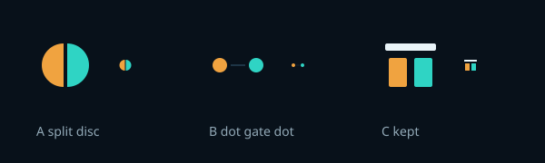

# onpar brand

<picture>
  <source media="(prefers-color-scheme: dark)" srcset="../assets/brand/lockup-horizontal-on-dark.svg">
  
</picture>

Every file here is generated by `python3 tools/brand.py`. Do not edit an SVG or
`tokens.css` by hand: change the geometry or the palette in the script and run it
again. It writes `site/assets/brand/` (served by the site), `docs/assets/brand/`
(linked from the README) and `site/public/favicon.svg` (the docs favicon), then
re-reads each file against the repo's SVG rules.

## The mark

The name is a claim: on par, two things level. In onpar the two things are the
incumbent, the closed model you pay for, in amber, and the candidate, the open
model you are proving, in teal. What decides whether they are level is the gate.

So the mark is two bars under a gate line. Both bars reach the line, and the line
is level because they do. It is what an onpar result looks like: the candidate
scored up to the line the incumbent set.

Three candidates were drawn in `tools/brand.py`.

- **A, split disc.** The strongest silhouette at 16 px, rejected because it is the
  half-filled circle glyph the site already uses for its theme toggle. It reads as
  a contrast icon before it reads as anything about models.
- **B, dot, gate, dot.** The embryo from the old header and social card, rejected
  because it does not survive 16 px. Each dot becomes two pixels, and side by side
  says connected, not level.
- **C, threshold bars.** Kept. It is rectangles on a pixel grid, so the favicon is
  drawn on whole pixels and stays crisp. In one colour it still reads as two equal
  bars under a line.

The animated logo plays once: the teal bar rises and the tilted gate settles level,
then it rests. Its first frame is already the rested mark, so a renderer that
ignores animation, or a reader who asked for reduced motion, sees the level mark.

## The wordmark

`onpar` is built, not typeset. Every letter is a ring, a stem or an arch in one
stroke weight, the mark's weight. In the horizontal lockup the x-height equals the
bar height, so the letters stand on the bars' baseline under the same gate line.
No font is loaded to draw it, and it renders the same everywhere.

The pages keep the system font stack for text. Loading Inter Tight, Inter and
JetBrains Mono from Google Fonts would send every visitor's address to a third
party, on a site whose first claim is zero telemetry and zero egress.

## Files

| File | Use |
|---|---|
| `mark.svg`, `mark-on-dark.svg` | the mark on light and dark surfaces |
| `mark-mono-black.svg`, `mark-mono-white.svg` | one-colour print, embossing, stamps |
| `lockup-horizontal.svg`, `-on-dark`, `-mono-black`, `-mono-white` | site nav, docs header, social card |
| `lockup-stacked.svg`, `-on-dark` | README hero, square placements |
| `logo-animated.svg`, `-on-dark` | horizontal lockup that levels once, then rests |
| `app-icon.svg` | rounded square tile, 512 px, mark centred |
| `favicon.svg` | 16 px grid, follows the browser's light or dark chrome |
| `tokens.css` | the design tokens, below |

Clear space around the mark is one bar width on every side. Never recolour the bars,
swap them or set them on a busy image. Amber is always left, because the incumbent
is where you start.

## Tokens

`tokens.css` is the single source for the landing page, the lab and the Starlight
docs. Dark is the default. `[data-theme='light']` selects light, and with no
attribute the reader's system preference decides.

| Group | Tokens |
|---|---|
| surfaces | `--void` `--deep` `--panel` `--panel2` `--line` `--line2` |
| inks | `--ink` `--ink2` `--ink3` |
| the two poles | `--incumbent` `--incumbent-dim` `--candidate` `--candidate-dim` `--candidate-wash` |
| signals | `--proof` (the evidence layer) `--alarm` |
| type | `--font-sans` `--font-mono` `--fs-2xs` to `--fs-lg`, `--fs-h2` `--fs-h1`, `--track-tight` `--track-caps` |
| shape | `--r-xs` to `--r-xl`, `--sp-1` to `--sp-8` |
| motion | `--dur-fast` `--dur-base` `--dur-slow` `--ease-out`; durations drop to 0 under reduced motion |

It also carries two helper classes, `.for-dark` and `.for-light`, which show the
brand image that matches the current theme.
