# Prove: per task, with intervals, or `?`

Is the open model on par with the one you pay for, task by task, and how sure
can you be?

`onpar prove` replays every eval item against the candidate and grades the reply
against your incumbent's answer. A replay is the whole step, not the bare prompt:
the system prompt, the earlier turns, the tool results and the tools offered all
go back exactly as the incumbent saw them. Grading is deterministic first.
Structural checks ask whether there is an answer and whether JSON is valid.
Task checks compare tool choice, arguments, exact matches and numbers. An LLM
judge is consulted only where those cannot decide, and only if you name one.

Every task shape gets a pass rate and a 95% Wilson score interval. A shape is
proven only when the whole interval clears the bar, 90% by default. The interval
is the point. At a perfect score the Wilson lower bound is n / (n + z²), with z²
about 3.84. Fifteen flawless items give a lower bound of about 0.80. It takes 35
flawless items, at about 0.901, to clear 90%. `samples_needed` in
`src/onpar/prove/stats.py` carries that arithmetic, and the report prints it for
every open shape.

The headline is a traffic-weighted verdict across shapes. Wilson does not cover
a weighted sum of proportions, so that figure is simulated from Jeffreys
posteriors and labelled as such. Scoring several shapes against one bar also
raises the chance that one passes by luck, so the report adds a Bonferroni line.

## The run

The candidate is qwen3-30b-a3b, served on this machine by `onpar run` through
MLX at q8 with thinking off. `--replay-sessions` adds the whole-session check
for the refund agent.

<!-- run: prove -->

## How to read it

- **Regret comes first.** Structured JSON scored `0% [0–9]` and stays on the
  incumbent. The collector's warning says why: 40 of 40 replies were not the
  JSON that `response_format` asked for, because this server does not enforce
  it. The replies in the resume ledger, `~/.onpar/story.candidate.jsonl`, show
  how: 13 are valid JSON arrays and 27 are not valid JSON, against 40 objects
  from the incumbent. That is a server finding, not a model verdict.
- **The weighted verdict is `75% [70–77]`.** It is a sum over shapes, each counted
  by its share of traffic.
- **Free text #1 scored `92% [80–97]`.** It needs 525 graded items to clear a 90%
  bar at that rate. Free text #2, at 84%, cannot clear the bar with more items.
- **Free text #3 scored `100% [88–100]` over 29.** It needs 35 items, so 6 more.
- **26 duplicate prompts were collapsed.** A prompt repeated within a shape is
  one observation asked twice. Every interval assumes independent items, so the
  copies merge, and an item passes only if every copy passed.
- **The judge was not used.** Every verdict above comes from deterministic
  graders.
- **COLLECTED reads 0.01s** because `--resume` reused replies already recorded
  under that prefix. Nothing was asked twice.

The engine probe confirms the structured-JSON finding against the same server
in three requests:

<!-- run: engine-probe -->

## The agentic block asks whether it made the same moves

On the left, look at what goes back to the candidate: everything the incumbent
saw. On the right, look at where the session stops: at the first call the
recording cannot answer.

Each agent step is teacher-forced
([ADR-0020](../../adr/0020-agentic-evals-replay-the-step-not-the-prompt.md)).
The candidate gets the exact prefix the incumbent saw and is asked for one move.
Three graders read that move:

- **Tool choice.** Did it call the same tool, or answer in text where the
  incumbent called one?
- **Arguments against the schema.** Every argument object must satisfy the tool
  schema the request offered. A right tool with a wrong argument fails here.
- **Tool leak.** A call that arrives as text, with no `tool_calls`, is a server
  parser fault. The detail names the server flag, not the model.

Decision agreement is Cohen's kappa over the action at each step, so a workload
dominated by one action cannot flatter it. Here it is `100% [90–100]` over 36
steps, κ=1.00. Both tools were called on all 12 of their steps.

`--replay-sessions` then runs each session end to end. When the candidate makes
the incumbent's call, the recorded tool result is fed back and the next step is
asked. A different call, a text answer where a tool was called, or a call the
recording cannot answer ends the session there. A miss is a stop, never a live
tool call. It is a path metric: a different route to the same outcome reads as
diverged, and the report says so. Here 12 of 12 sessions followed the
incumbent's path to the end.

## The collector names server faults

Collection is the one step that sends anything, to the one endpoint you name.
A failed collection is not a failed answer. An item that got no reply is dropped,
the interval widens, and the count lost is printed beside the verdict. Two
faults get their own lines, from `src/onpar/prove/collect.py`:

- **Format not enforced.** Replies that ignore `response_format` are counted and
  named as a server setting, as in the run above.
- **Thinking exhausted the token budget.** A reasoning model that spends the
  whole budget thinking returns no content. The collector counts those replies
  and says to serve with thinking off, which `onpar run` does by default, or to
  raise the token limit. Only `content` is ever graded, never the reasoning.

## A judge, if you need one

No judge is built in. `--judge-endpoint URL --judge-model NAME` names one, and
the model is stamped on the receipt. Each comparison runs twice with positions
swapped, and a judge that changes its answer with the order is recorded as
uncertain, never averaged.

A judge's word counts only once a human has checked it:

1. `onpar prove ... --judge-sample judged.jsonl` appends every comparison the
   judge sees, and its answer, to a ledger.
2. `onpar label judged.jsonl` walks you through those comparisons blind, in the
   same order, with no sight of the judge's answer.
3. `onpar prove ... --judge-labels judged.jsonl` measures the human-agreement
   rate from that ledger.

Below 20 labelled comparisons or 75% agreement, judge cells render as unknown.
An unmeasured judge is reported as `UNMEASURED`, and the gate refuses to
advance on it. Evidence that rests on the judge alone never moves traffic.

## When it says no

Look at the agentic block again: 100% decision agreement, κ=1.00, 12 of 12
sessions to the end, and four shapes at 100%. The verdict is still
`Move 0% of traffic`.

A perfect score over 12 items is a lower bound of 76%, not a pass. Each open
shape says how many more graded items would settle it, or that more items will
not. One shape is proven below the bar and must stay on the incumbent. The
saving reads unknown because no cost was passed.

## The knobs that matter

- `--candidate-endpoint URL` collects the candidate's replies. Without it, a
  freshly distilled set has nothing to grade and is refused.
- `--candidate-model NAME` is the name the endpoint knows the model by, when it
  differs from `--candidate`.
- `--replay-sessions` adds the whole-session replay for agent workloads.
- `--resume PREFIX` records each reply as it lands and reuses it next time.
  Collection is the only step that spends real money.
- `--bar` sets the equivalence bar. The default is 0.9.
- `--incumbent-cost`, `--candidate-cost` and `--traffic-window` turn the saving
  into a range. Without them the saving reads unknown.
- `--fingerprints FILE` records what identified each model, so `onpar guard`
  can catch a silent swap later.
- `--out receipt.json` writes [the receipt](../reference/20-receipt.md).

Next: [migrate](60-migrate.md), shadow first.
